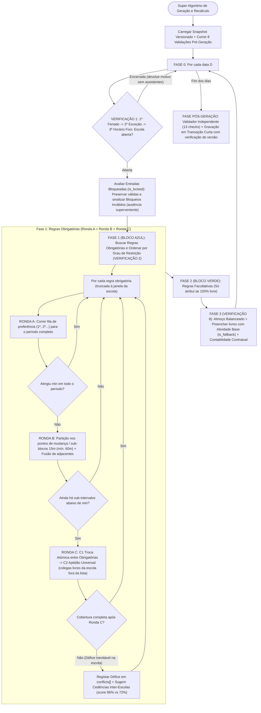

# Super Algoritmo de Geração de Escalas (Motor Híbrido SGDE)

Este documento especifica a versão final e unificada do **Motor de Geração, Recálculo e Edição de Escalas**, combinando:
1. **A arquitetura e as 11 entidades reais do Backend Laravel** (Regras Obrigatórias vs. Facultativas, Filas de Preferência `1º, 2º, 3º...`, Janela de Almoço Flexível, Horários Fixos e Rotativos `weekly`/`biweekly`/`monthly` por mês civil, Exceções de Horário `AssistantException` de turno especial ou `unavailable`, Faltas Totais/Parciais `Absence`, Transferências Inter-Escolas `AssistantTemporaryAssignments`, Entradas Bloqueadas `is_locked`, Filtro RGPD `is_active && !is_anonymized` e Atividade Base `is_fallback = true` `"Apoio Escola"`).
2. **As melhores práticas do Protótipo SGDE, do `ScheduleGenerationService` e da Proposta de Arquitetura v1.1** (Invariantes e Determinismo, Validações Pré e Pós-Geração, Divisão nos Pontos de Mudança `[início, fim)`, Rastreio de *Quem Substitui Quem*, Códigos Padronizados `skipped[]`, Partição em Sub-blocos com fusão de blocos adjacentes, **Trocas Atómicas entre Tarefas Obrigatórias**, **Aptidão Universal (Fallback Interno Automático)**, **Deteção de Bloqueios Inválidos por Ausência Superveniente**, **Contabilidade Separada de Horas Contratuais vs. Atribuídas**, **Recálculo Incremental com Snapshot, Idempotência e Transação Curta**, Avaliação de Impacto na Escola de Origem `causes_origin_shortfall` + `score` e Suporte Completo ao Editor Interativo Diário).

---

## 1. Regras de Ouro (Invariantes do Motor)

O motor garante matematicamente que estas **9 regras nunca são violadas**:

| Código | Invariante (Regra de Ouro) | Como é garantido |
| :--- | :--- | :--- |
| **R1** | **As atividades nunca mudam de hora:** Uma regra das `09:00–10:30` acontece sempre às `09:00–10:30` (recortada apenas se a escola abrir mais tarde ou fechar mais cedo nesse dia); apenas muda quem a executa. | Validação `post-fixed-hours` |
| **R2** | **Prioridades Flexíveis + Aptidão Universal:** A lista `schedule_rule_assistant` (`1º..N`) define a ordem de preferência (titulares e suplentes), mas qualquer assistente da escola tem aptidão universal para executar qualquer atividade se a fila da regra se esgotar antes de atingir `min`. | Rondas A, B e C |
| **R3** | **Ninguém trabalha fora do seu turno contratual, fora da janela da escola, em feriado ou durante uma falta:** O motor automático nunca prolonga o turno de um assistente nem o chama na folga. Horas cortadas por encerramento da escola são contabilizadas separadamente das horas atribuídas. | Fase 0 + Verificações 3, 4 e 5 (`post-window`, `post-blocked`) |
| **R4** | **Ninguém fica sem almoçar:** Todo o assistente com `lunch_enabled = true` tem garantido um bloco contínuo `>= lunch_duration_minutes` dentro da sua janela `[lunch_start, lunch_end]`. | Verificação 5 + Fase 3 (`post-lunch`) |
| **R5** | **Zero sobreposições (ninguém está em dois sítios à mesma hora):** Usando intervalos semiabertos `[início, fim)` (uma tarefa que termina às `09:00` não colide com outra que começa às `09:00`), ninguém tem duas tarefas simultâneas na mesma escola ou entre escolas diferentes. | Verificação 6 (`post-no-overlap`) |
| **R6** | **Hierarquia de Substituição e Trocas Atómicas (`Swap`):** Uma tarefa **Obrigatória** pode substituir **"Apoio Escola"**, substituir uma **Facultativa** (realocando a facultativa em cascata ao próximo suplente) ou realizar uma **Troca Atómica com outra Obrigatória** (mover o assistente X da Obrigatória 1 para a Obrigatória 2 *apenas se* um assistente Y livre assumir simultaneamente a vaga de X na Obrigatória 1, sem perder cobertura). | Verificação 6 e Ronda C1 (`post-valid-swap`) |
| **R7** | **Partição Inteligente e Fusão Contínua:** Se nenhum candidato cobrir uma tarefa obrigatória inteira (ex.: `08:00–10:00`), o motor divide a necessidade nos pontos de mudança (múltiplos de 15 min, mín. `min(60m, restante)`), garantindo `>= min` assistentes distintos em cada sub-intervalo e fundindo blocos adjacentes da mesma pessoa na mesma atividade. | Verificação 7 — Ronda B |
| **R8** | **Bloqueios Válidos vs. Bloqueios Inválidos por Ausência:** Entradas `is_locked = true` de assistentes presentes são preservadas e contam para o `min`. Porém, se um assistente com `is_locked = true` tiver uma **falta (`Absence`) superveniente**, o registo bloqueado é mantido para auditoria mas **não conta como cobertura efetiva**, gerando conflito explícito (`locked_absence_conflict`) e acionando substituição. | Fase 0 + `post-locked-absence` |
| **R9** | **Determinismo Puro e Transação Curta com Idempotência:** Os mesmos dados de entrada geram **sempre exatamente a mesma escala** (desempate por menor carga planeada, continuidade e `id` ascendente). O cálculo corre em memória sobre um *snapshot* versionado e grava numa transação curta validando alterações concorrentes. | `post-deterministic` + Secção 6.1 |

---

## 2. Entidades e Modelos do Backend Envolvidos

| Conceito no Algoritmo | Modelo / Tabela no Backend | Notas de Implementação |
| :--- | :--- | :--- |
| **Horário da Escola** | `OperatingHoursResolver` (`Holiday`, `SchoolOperatingException`, `SchoolOperatingRule` + `SchoolOperatingRuleDay`) | Prioridade: `1º Feriado -> 2º Exceção da Escola -> 3º Horário Fixo`. |
| **Assistente Elegível (RGPD)** | `Assistant` + `User` | Só entram no motor assistentes com `user.is_active = true`, `deleted_at IS NULL` e `is_anonymized = false`. Possui flag `available_for_transfer`. |
| **Regras do Motor** | `ScheduleRule` + pivot `schedule_rule_assistant` | `type` (`mandatory`/`obrigatoria` vs `optional`/`facultativa`), `period_start`, `period_end`, `min`, `valid_from`, `valid_until`, `days_of_week`. Lista de preferência ordenada por `priority` (`1º, 2º, 3º...`). |
| **Faltas (Totais ou Parciais)** | `Absence` | `valid_from`, `valid_until`, `start_time` (opcional), `end_time` (opcional). Se `start_time = null`, falta o dia todo (`skipped: absence`). |
| **Transferências / Cedências** | `AssistantTemporaryAssignments` (`assistant_temporary_assignments`) | `assistant_id`, `origin_school_id`, `destination_school_id`, `valid_from`, `valid_until`, `start_time` (opcional), `end_time` (opcional). Disponibilidade para cedência (`available_for_transfer`) inicia a pesquisa, mas só uma cedência aprovada/confirmada transfere efetivamente o assistente. |
| **Exceção de Horário do Assistente** | `AssistantException` | Vigente se `valid_from <= dia <= valid_until` e `days` incluir o dia da semana (`0=Seg..6=Dom`). Se `type = 'unavailable'` (ou sem horas), bloqueia o assistente nesse dia (`skipped: unresolved_exception`). Se tiver `start_time` e `end_time` (ex.: amamentação `09:00–16:00`), **substitui o turno normal** nesse dia. |
| **Horário Normal (Fixo ou Rotativo)** | `AssistantScheduleProfile` + `AssistantScheduleShift` | Perfil em vigor na data. Suporta `fixo` e `rotativo` (`weekly`, `biweekly`, `monthly`) alinhado às semanas ISO (Segunda-feira) e meses civis reais (nunca `4 semanas = 1 mês`). |
| **Atividade Base ("Tapa-Buracos")** | `ActivityType` (`is_fallback = true`, por omissão `'Apoio Escola'`, `is_system = true`) | Nível mais baixo de prioridade. Sempre ativa, não eliminável e bloqueada na criação de regras. Preenche todos os tempos de trabalho livres na Fase 3. |
| **Escala, Rastreio e Lock** | `Schedule` (`draft`/`published`/`archived`) + `ScheduleEntry` | `ScheduleEntry` guarda `is_locked`, `replaced_assistant_id` (opcional) e `replacement_reason` (opcional) para auditoria visual de quem substituiu quem. |

### Códigos Padronizados de Rejeição de Candidatos (`skipped[]`)
Sempre que um assistente da fila de uma regra não pode ser alocado diretamente, o motor regista na resposta da API o código normalizado do motivo:
- `inactive_assistant`: Utilizador inativo, apagado ou anonimizado (`!user.is_active || deleted_at || is_anonymized`).
- `different_school`: Assistente pertence a outra escola (ou foi cedido a outra escola nesse horário).
- `absence`: Falta de dia inteiro ou falta parcial sobreposta ao horário da regra.
- `unresolved_exception`: Assistente com `AssistantException` do tipo `unavailable` nesse dia.
- `outside_working_period`: Assistente de folga nesse dia da semana ou a tarefa cai fora do seu turno `[entry_time, exit_time]`.
- `lunch_conflict`: Atribuir a tarefa deixaria o assistente com menos de `lunch_duration_minutes` contínuos livres dentro da sua janela `[lunch_start, lunch_end]`.
- `overlapping_assignment`: Já está ocupado noutra tarefa obrigatória (sem possibilidade de troca atómica sem défice) ou entrada bloqueada válida (`is_locked = true`) no mesmo horário.

---

## 3. Fase Pré-Geração: Validações dos Dados de Entrada (`Pre-Flight Checks`)

Antes de gerar a escala para o intervalo `[data_inicio, data_fim]`, o motor corre **8 validações rápidas** sobre os dados de entrada para distinguir **erros/ambiguidades de configuração** de **falta real de pessoal**:

| Código | O que verifica antes de gerar | Exemplo de Disparo | Gravidade |
| :--- | :--- | :--- | :--- |
| `pre-profile` | Todos os assistentes ativos (`is_active && !is_anonymized`) da escola têm `AssistantScheduleProfile` válido (sem perfis contraditórios sobrepostos) para os dias a gerar? | A Maria tem perfil que expirou a `2026-09-30` e estamos a gerar Outubro. | **Aviso de Configuração** (Maria será ignorada nos dias sem perfil) |
| `pre-rotation` | Os perfis com `type = 'rotativo'` têm `starts_with` (`A` ou `B`), `rotation_period` (`weekly`, `biweekly`, `monthly`) e ambos os turnos A e B configurados? | O João é rotativo mas falta configurar o Turno B. | **Erro Bloqueante** |
| `pre-shift-window` | Os turnos dos assistentes estão contidos (ou pelo menos intersetam) o horário normal de abertura/fecho da escola? | Turno das `07:00–15:00` numa escola que só abre às `08:00`. | **Aviso** (O motor recorta a entrada para as `08:00` e regista os 60m cortados na contabilidade contratual) |
| `pre-lunch-valid` | Em cada turno com `lunch_enabled = true`, o intervalo `[lunch_start, lunch_end]` está dentro do turno e tem duração `>= lunch_duration_minutes`? | Janela de almoço `12:00–12:30` (30m), mas pede `lunch_duration_minutes = 60`. | **Erro Bloqueante** |
| `pre-rules-valid` | Todas as regras ativas têm `period_start < period_end`, atividade com `is_fallback = false` e pelo menos `min` assistentes associados na lista de preferências? | Regra "Portaria" pede `min = 2`, mas o Admin só colocou 1 assistente na lista da regra. | **Aviso** (A 2ª vaga terá de recorrer à Ronda C — Aptidão Universal) |
| `pre-ambiguous-overlap` | Existem duas ou mais regras ativas para a **mesma atividade** que se sobreponham no mesmo dia e horário? | Regra 1: "Portaria `08:00–10:00` (`min=2`)" e Regra 2: "Portaria `09:00–11:00` (`min=1`)". | **Aviso de Ambiguidade** (Sinaliza ao Admin se pretendia acumular `2+1=3` pessoas às `09:00–10:00` ou se é duplicação) |
| `pre-grain-15m` | Os horários de turnos, almoços e regras estão alinhados em múltiplos de 5 ou 15 minutos? | Regra com início às `09:03`. | **Aviso** |
| `pre-dow-sync` | Conversão única e coerente do dia da semana (`0 = Segunda-feira ... 6 = Domingo` em todo o motor, datas em UTC puro). | Incoerência entre `Carbon::dayOfWeek` (Dom=0) e convenção do projeto (Seg=0). | **Erro Interno** |

---

## 4. Detalhe de Todas as Verificações do Motor (Com Exemplos Comentados Caso X vs. Caso Y)

---

### VERIFICAÇÃO 1: Horário de Funcionamento da Escola no Dia, Elegibilidade RGPD e Cedências (Fase 0)
**O que está a ser verificado:**
Para cada dia `D`, o motor consulta o `OperatingHoursResolver` (`1º Feriado -> 2º Exceção da Escola -> 3º Horário Fixo`) e filtra os assistentes elegíveis (`user.is_active = true`, `deleted_at = null`, `is_anonymized = false`), identificando quem está cedido a esta escola ou desta para outra.

* **Caso A (Feriado Global ou Exceção da Escola Encerrada):**
  * *Exemplo:* Dia `2026-12-08` (Feriado) ou `SchoolOperatingException` com `is_closed = true`.
  * *O que fazemos:* `is_open = false`. O algoritmo **ignora o dia** (`continue`), devolve `reason_type` (`holiday` | `exception` | `weekend`) sem listar linhas de assistentes e não gera nenhuma entrada.
* **Caso B (Exceção da Escola Aberta com Horário Reduzido + Recorte de Turnos e Regras):**
  * *Exemplo:* O horário normal da escola é `08:00–18:00`, mas no dia `2026-12-23` há uma exceção aberta das `09:00` às `15:00`. A Maria tem turno normal das `08:00` às `16:00` e existe uma regra das `08:30` às `10:00`.
  * *O que fazemos:* O horário da escola passa a ser `09:00–15:00`. Tanto o turno da Maria (`09:00–15:00`) como a regra (`09:00–10:00`) são **recortados automaticamente à janela da escola** (`max(start, opening_time)` até `min(end, closing_time)`). Se uma regra cair totalmente fora (ex.: `15:30–17:00`), é ignorada nesse dia.
* **Caso C (Cedências / Transferências Temporárias de Entrada e Saída):**
  * *Exemplo:* O Pedro pertence à Escola B, mas tem um registo em `assistant_temporary_assignments` com `destination_school_id = Escola A` no dia `2026-10-21` das `08:00` às `13:00`.
  * *O que fazemos:* Na Escola B (origem), o Pedro fica bloqueado das `08:00–13:00` (`skipped: different_school`). Na Escola A (destino), o Pedro passa a estar disponível das `08:00–13:00`.

---

### VERIFICAÇÃO 2: Seleção e Ordenação Inteligente das Regras do Dia
**O que está a ser verificado:**
Para o dia `D`, buscamos as regras ativas onde `valid_from <= D <= valid_until` e `days_of_week` contém o dia da semana.
Separamos em dois grupos: **Fase 1 (Obrigatórias / Bloco Azul)** e **Fase 2 (Facultativas / Bloco Verde)**.

**Como ordenamos as regras dentro de cada Fase (e porquê):**
1. **1º Critério — Grau de Restrição:** `(nº de candidatos na fila da regra - regra.min)` **ascendente** (as regras com menos suplentes disponíveis correm primeiro).
2. **2º Critério — Hora de Início e Fim:** `period_start ASC, period_end ASC`.
3. **3º Critério — Determinismo:** `valid_from ASC, regra.id ASC`.

* **Exemplo Prático (Caso X vs. Caso Y):**
  * Às `09:00–10:00` há duas Regras Obrigatórias:
    * **Regra A (Portaria, `min = 1`):** Fila = `[1º Maria, 2º João, 3º Carla]` (margem = `3 - 1 = 2`).
    * **Regra B (Apoio Aluno NEE, `min = 1`):** Fila = `[1º Maria]` (margem = `1 - 1 = 0`).
  * *Sem ordenação por restrição (Caso Mau):* Se a Portaria corresse primeiro (por ter `id = 1`), escolhia a `1ª Maria`. Quando chegasse ao Apoio Aluno NEE (`id = 2`), a Maria já estava ocupada noutra obrigatória e o Aluno NEE ficava **sem ninguém**!
  * *Com a nossa ordenação (Caso Bom):* A **Regra B (Apoio Aluno NEE)** tem margem `0`, por isso corre **primeiro** e fica com a Maria. Em seguida corre a **Regra A (Portaria)**: vê que a `1ª Maria` está ocupada no Aluno NEE (`skipped: overlapping_assignment`), avança para o `2º João` (que está livre) e atribui a Portaria ao João (registando que o João entrou em substituição da titular Maria). **Ambas as regras ficam 100% cobertas!**

---

### VERIFICAÇÃO 3: Faltas (Totais ou Parciais) e Rastreio do Titular Ausente
**O que está a ser verificado:**
Ao avaliar um candidato da fila para o intervalo `[inicio, fim]`, verificamos primeiro se está ativo (`user.is_active && !is_anonymized`) e se tem falta (`Absence`) ou cedência de saída (`AssistantTemporaryAssignments`) que intersete `[inicio, fim]`.

* **Caso X (Falta de Dia Inteiro):**
  * *Exemplo:* A `1ª Maria` tem `Absence` de `2026-10-20` a `2026-10-22` com `start_time = null` e `end_time = null`.
  * *O que fazemos:* Regista `skipped[]` com `reason = 'absence'`, guarda `titular_ausente = Maria` e avança para o `2º candidato` da fila. Quando o `2º candidato` (João) assumir a vaga, a entrada do João ficará com `replaced_assistant_id = Maria.id` e `replacement_reason = 'absence'`.
* **Caso Y (Falta Parcial — Consulta Médica num horário específico):**
  * *Exemplo:* O `1º João` tem uma `Absence` no dia `2026-10-21` com `start_time = 09:00` e `end_time = 11:00`.
  * *Subcaso Y1 (Regra das `09:30` às `10:30`):* Há sobreposição (`09:30 < 11:00 && 09:00 < 10:30`). Regista `skipped: absence` e salta para o 2º da fila.
  * *Subcaso Y2 (Regra das `14:00` às `16:00`):* Não há sobreposição com `09:00–11:00`. O João já regressou da consulta -> **assume normalmente a sua tarefa da tarde!**

---

### VERIFICAÇÃO 4: Determinação do Horário de Trabalho do Assistente (`AssistantException` vs. Fixo vs. Rotativo)
**O que está a ser verificado:**
Descobrir qual o horário de trabalho contratual do assistente no dia `D`, aplicando no fim o recorte (clipping) à janela de abertura da escola.

* **Caso W (Tem `AssistantException` vigente do tipo Indisponível — `type = 'unavailable'` ou sem horas):**
  * *Exemplo:* O assistente tem uma exceção administrativa sem horas ou com `type = 'unavailable'` para hoje.
  * *O que fazemos:* Bloqueia o assistente nesse dia com `skipped: unresolved_exception` e passa ao próximo candidato.
* **Caso X (Tem `AssistantException` vigente com Horário Especial — `start_time` e `end_time`):**
  * *Exemplo:* A Carla tem uma `AssistantException` ("Horário Amamentação") de `2026-09-01` a `2026-12-31`, com `days = [0, 1, 2, 3, 4]` (Seg a Sex), `start_time = 09:00`, `end_time = 16:00`. Hoje é Quarta-feira (`2`).
  * *O que fazemos:* Substitui o turno normal e usa o horário e almoço da exceção (`09:00–16:00`).
* **Caso Y (Tem `AssistantException` vigente nas datas, mas NÃO para este dia da semana):**
  * *Exemplo:* Exceção só às Sextas-feiras (`days = [4]`), e hoje é Terça-feira (`1`).
  * *O que fazemos:* Ignora a exceção hoje e vai buscar o horário normal (`AssistantScheduleProfile`).
* **Caso Z1 (Horário Normal `fixo`):**
  * *Exemplo:* Perfil `type = 'fixo'`. Busca o turno `A` e verifica se o dia da semana atual consta em `assistant_schedule_shift_days`. Se não constar, o assistente está de **folga** hoje (`skipped: outside_working_period`).
* **Caso Z2 (Horário Normal `rotativo` — Semanal, Quinzenal ou Mensal):**
  * *Exemplo:* Perfil `type = 'rotativo'`, `valid_from = 2026-09-02` (Quarta-feira), `starts_with = 'A'`.
  * *Cálculo exato alinhado ao calendário ISO (em UTC):*
    * Seja `segunda_inicio` a Segunda-feira da semana de `valid_from` (`2026-08-31`) e `segunda_atual` a Segunda-feira da semana do dia `D`.
    * `weeksDiff = diferencaEmSemanasInteiras(segunda_inicio, segunda_atual)`.
    1. **`weekly` (Semanal — muda todas as Segundas-feiras):**
       * `indice = weeksDiff % 2`. Se `0` -> usa `starts_with`; se `1` -> usa o turno oposto (`A <-> B`).
    2. **`biweekly` (Quinzenal — muda a cada 2 Segundas-feiras):**
       * `indice = intdiv(weeksDiff, 2) % 2`. Semanas 0 e 1 -> Turno inicial; Semanas 2 e 3 -> Turno oposto.
    3. **`monthly` (Mensal — muda no dia 1 de cada mês):**
       * `monthsDiff = (anoD - anoInicio) * 12 + (mesD - mesInicio)`.
       * `indice = monthsDiff % 2`. Mês par -> Turno inicial; Mês ímpar -> Turno oposto.

---

### VERIFICAÇÃO 5: Compatibilidade de Turno e Janela Flexível de Almoço (`canFitActivityWithLunch`)
**O que está a ser verificado:**
Para o intervalo `[inicio, fim]` que queremos atribuir ao assistente:
1. Está dentro do turno efetivo do assistente hoje (`inicio >= assistente.entry_time && fim <= assistente.exit_time`)? Se não estiver, rejeita com `skipped: outside_working_period`.
2. Se o assistente tem almoço ativo (`lunch_enabled = true`), depois de descontarmos da janela `[lunch_start, lunch_end]` todas as tarefas já atribuídas hoje, eventuais faltas parciais e esta nova tarefa `[inicio, fim]`, **ainda sobra dentro de `[lunch_start, lunch_end]` pelo menos um bloco contínuo livre de duração `>= lunch_duration_minutes`**? Se não sobrar, rejeita com `skipped: lunch_conflict`.

* **Caso X (Compatível — Tarefa ocupa metade da janela de almoço):**
  * *Exemplo:* Janela de almoço `12:00–14:00`, `lunch_duration_minutes = 60`. Tarefa a testar: "Vigilância Almoço `12:00–13:00`".
  * *Cálculo:* Subtraindo `12:00–13:00` à janela `12:00–14:00`, sobra livre `13:00–14:00` (`60 min >= 60 min`).
  * *Decisão:* **Compatível!** O assistente faz a Vigilância das `12:00–13:00` e fica com o almoço garantido das `13:00–14:00`.
* **Caso Y (Incompatível — Tarefa parte a janela ao meio sem deixar 60 min seguidos):**
  * *Exemplo:* Janela de almoço `12:00–14:00` (`60 min`). Tarefa a testar: `12:30–13:30`.
  * *Cálculo:* Sobram dois pedaços livres: `12:00–12:30` (30 min) e `13:30–14:00` (30 min). O maior bloco contínuo livre é de `30 min < 60 min`.
  * *Decisão:* **Incompatível (`skipped: lunch_conflict`)!** Rejeita para proteger a hora de almoço do assistente e passa ao próximo candidato.

---

### VERIFICAÇÃO 6: Bloqueios Válidos vs. Bloqueios Inválidos, Sobreposição e Trocas (`Swap`)
**O que está a ser verificado:**
1. **Avaliação prévia das entradas bloqueadas (`is_locked = true`):**
   * *Caso A (Bloqueio Válido):* O assistente está presente, dentro do seu turno/disponibilidade e sem falta sobreposta -> a entrada bloqueada é preservada e **conta para o `min` da regra**.
   * *Caso B (Bloqueio Inválido por Ausência Superveniente — `locked_absence_conflict`):* O Admin bloqueou a `Maria` na Portaria (`08:00–10:00`, `is_locked = true`), mas mais tarde a Maria registou falta médica (`Absence`) nesse dia.
     * *O que fazemos:* O registo da Maria é preservado na secção de ausentes (`disabled`) para rastreabilidade, mas **NÃO conta como cobertura efetiva da Portaria** (`atribuidos` não incrementa), é emitido um aviso explícito `locked_absence_conflict` e o motor procura substituto para cobrir essa vaga!
2. **Avaliação de sobreposição ao testar um candidato em `[inicio, fim)`:**
   * **No BLOCO AZUL (A processar uma Regra Obrigatória):**
     * **Caso 1 (Sem sobreposição):** Atribui a tarefa obrigatória! Se um titular anterior da fila falhou (por falta ou conflito), grava `replaced_assistant_id = titular.id`.
     * **Caso 2 (Sobrepõe apenas com uma Regra Facultativa não bloqueada):**
       1. Como a Obrigatória tem nível superior à Facultativa, faz **Swap (Troca)**: remove a tarefa facultativa daquele assistente e atribui-lhe a tarefa obrigatória;
       2. Regista um Aviso Informativo (`insights[]`);
       3. **Realocação em Cascata:** Tenta de imediato realocar a Regra Facultativa desalojada ao **próximo suplente livre** da lista dessa regra facultativa!
     * **Caso 3 (Sobrepõe com outra Regra Obrigatória ou entrada `is_locked = true` válida):**
       * Na **Ronda A**, não substitui diretamente; regista `skipped: overlapping_assignment` e tenta os próximos suplentes livres da fila.
       * Se a fila se esgotar sem atingir `min`, a **Ronda C1 (Troca Atómica entre Obrigatórias)** verificará se a outra Regra Obrigatória pode ceder este assistente trocando-o atomicamente por um suplente livre dela!
   * **No BLOCO VERDE (A processar uma Regra Facultativa):**
     * **Caso Único:** Só atribui se **não houver sobreposição nenhuma**. Uma regra facultativa nunca remove nem prejudica outra tarefa.

---

### VERIFICAÇÃO 7: Alocação em 3 Rondas (A: Integral -> B: Partição 15m -> C: Troca Atómica & Aptidão Universal) + Mobilidade Inter-Escolas
**O que está a ser verificado:**
Como garantir que cada intervalo `[t_i, t_{i+1})` dentro de `[regra.period_start, regra.period_end)` tem pelo menos `regra.min` assistentes distintos em simultâneo.

#### **Ronda A — Tentativa de Cobertura Integral com a Lista da Regra (`[inicio_efetivo, fim_efetivo)`):**
* Percorre os candidatos da fila de preferência da regra (`1º, 2º, 3º...`) tentando atribuir o período completo.
* Assim que `atribuidos == regra.min`, **pára imediatamente (`break`)**.

#### **Ronda B — Partição Inteligente nos Pontos de Mudança / Sub-blocos de 15m (com Fusão de Adjacentes):**
* Corre se a Ronda A terminou com `atribuidos < regra.min`.
* **Exemplo Real (3 pessoas na Portaria com substituição a meio — Secção 10.A):**
  * Necessidade: "Portaria" das **`08:00` às `10:00`**, `min = 3`.
  * `Maria` e `João` estão disponíveis das `08:00` às `10:00` (atribuídos na Ronda A -> `2 de 3`).
  * Para a 3ª vaga: a `Ana` só está disponível das **`08:00` às `09:00`** e o `Carlos` só das **`09:00` às `10:00`**.
  * *O que faz a **Ronda B**:* Divide a 3ª vaga nos pontos de mudança (múltiplos de 15 min, respeitando `minStint = min(60 min, tempo restante)`): atribui `08:00–09:00` à Ana (`3 de 3`) e `09:00–10:00` ao Carlos (`3 de 3`). Se a mesma pessoa ficar com sub-blocos consecutivos na mesma atividade, o motor **une-os (`merge`)** num único bloco contínuo.

#### **Ronda C — Troca Atómica entre Obrigatórias (`C1`) + Aptidão Universal na Escola (`C2`):**
Se após as Rondas A e B ainda existirem sub-intervalos abaixo de `regra.min`, antes de declarar défice o motor executa dois mecanismos de resolução conjunta dentro da própria escola:
1. **Sub-ronda C1 — Troca Atómica entre Tarefas Obrigatórias (Prioridades Flexíveis):**
   * *Exemplo Real (Secção 10.C):* A `Ana` falta à **Portaria (`08:00–09:00`)**. O único candidato da Portaria presente é o `João`, mas o `João` já foi alocado à **Limpeza (`08:00–09:00`)**. No entanto, o `Carlos` está livre (ou em *"Apoio Escola"*) das `08:00–09:00` e pode fazer a **Limpeza**.
   * *O que faz o motor:* Avalia se mover o `João` da Limpeza para a Portaria permite colocar simultaneamente o `Carlos` na Limpeza sem deixar a Limpeza abaixo do seu `min` e respeitando almoços e turnos. Como ambos os postos ficam 100% cobertos, aplica a **troca como um conjunto atómico** (nunca retira o João sem colocar o Carlos) e regista em `insights[]` (`atomic_mandatory_swap`).
2. **Sub-ronda C2 — Aptidão Universal (Apoio Interno Automático fora da lista da regra):**
   * Como **qualquer assistente da escola tem aptidão universal para executar qualquer atividade** (a lista `schedule_rule_assistant` expressa preferências e não exclusão), se ainda faltar cobertura após C1, o motor procura assistentes ativos da mesma escola que não estavam na lista da regra mas que estejam em serviço nesse intervalo, com almoço respeitado e sem tarefa obrigatória atribuída.
   * Desempata por: **1º Continuidade no posto -> 2º Menor carga acumulada de tarefas obrigatórias (equidade) -> 3º `id` ascendente**.
   * Se encontrar, atribui automaticamente a vaga com `replacement_reason = "internal_universal_fallback"` e emite um `insight` informativo ao Admin.

#### **Se mesmo após a Ronda C sobrar algum intervalo sem cobertura (`Défice Inevitável na Escola + Pesquisa de Cedências`):**
Quando a necessidade simultânea da escola supera o total de assistentes disponíveis na própria escola (ex.: 4 postos obrigatórios em simultâneo e apenas 3 assistentes ao serviço na escola), o motor regista o défice explícito em `conflicts[]` e executa `findTransferCandidates`:
* **Mobilidade Temporária Inter-Escolas (`available_for_transfer = true`):**
  * Pesquisa assistentes ativos de outras escolas ativas com `available_for_transfer = true`, turno compatível e sem falta nesse horário, calculando o **Impacto na Escola de Origem (`causes_origin_shortfall`)**:
    * **`causes_origin_shortfall = false` (`score = 96%` — Selecionável):** O assistente está apenas em *"Apoio Escola"* ou tarefa facultativa na escola de origem (não se resolve uma escola criando um défice noutra).
    * **`causes_origin_shortfall = true` (`score = 72%` — `disabled` com Tooltip de Impacto):** O assistente faz parte de uma tarefa obrigatória na escola de origem nesse horário cuja equipa ficaria abaixo do `min` se ele saísse (*Tooltip: "Indisponível / Impacto na origem: atribuído à tarefa obrigatória «X» na escola «Y»"*).
* Uma sugestão não efetua a cedência automaticamente: só após confirmação na modal o sistema grava em `assistant_temporary_assignments`, cria a `ScheduleEntry` com **`is_locked = true`** e revalida origem e destino.

---

### VERIFICAÇÃO 8: Fase 3 — Fixação Balanceada do Almoço, Preenchimento com «Apoio Escola» e Contabilidade Contratual
**O que está a ser verificado:**
Terminadas as Fases 1 (Obrigatórias) e 2 (Facultativas), para cada assistente que trabalha hoje na escola:
1. **Fixar a Pausa Exata de Almoço (`[almoco_inicio, almoco_fim)` de duração `lunch_duration_minutes`):**
   * **Atenção:** Nunca se pinta a janela inteira `12:00–14:00` (2h) como almoço se `lunch_duration_minutes = 60`!
   * Se o assistente já tem parte da janela `[lunch_start, lunch_end]` ocupada por uma tarefa (ex.: Vigilância das `12:00–13:00`), o almoço de 60 min é fixado no bloco livre restante (`13:00–14:00`).
   * Se o assistente tem a janela `12:00–14:00` toda livre, o motor usa um **alternador balanceado** para colocar metade dos assistentes a almoçar na 1ª metade (`12:00–13:00`) e a outra metade na 2ª metade (`13:00–14:00`), garantindo que a escola nunca fica vazia à hora de almoço.
2. **Preencher os intervalos livres com a Atividade Base (`is_fallback = true` — `"Apoio Escola"`):**
   * Pega no turno efetivo recortado do assistente `[inicio_efetivo, fim_efetivo)` e subtrai:
     * Tarefas atribuídas (Obrigatórias, Facultativas e `is_locked` válidas);
     * Bloco exato de almoço fixado (`lunch_duration_minutes`);
     * Faltas parciais (`Absence` com horas);
     * Cedências parciais de saída (`AssistantTemporaryAssignments` para outra escola).
   * Todos os intervalos livres que sobrarem são preenchidos com a **Atividade Base do Sistema (`ActivityType` com `is_fallback = true`, por omissão `"Apoio Escola"`)**.
   * **Regras de Domínio para a Atividade Base (`is_fallback = true`):**
     * **Sempre ativa e não eliminável:** Cada escola tem exatamente uma atividade com `is_fallback = true`, `is_system = true` e `active = true`. O administrador pode personalizar o seu **nome** e **cor**, mas não a pode desativar (`active` não pode passar a `false`) nem eliminar (`can_delete = false`).
     * **Bloqueada na criação de Regras de Horário (`ScheduleRules`):** Como o objetivo desta atividade é preencher automaticamente os tempos livres na Fase 3, ela **não pode ser selecionada** ao criar ou editar Regras de Horário (filtrada no seletor do Frontend e validada com erro `422` no `StoreScheduleRuleRequest` / `UpdateScheduleRuleRequest` do Backend).
     * **Disponível no Editor Manual de Escalas (`MatrixGrid`):** Continua disponível na paleta de pintura manual para que o administrador possa substituir blocos manualmente se desejar.
3. **Contabilidade Separada de Horas Contratuais vs. Horas Atribuídas (`hours_accounting`):**
   * Preencher o tempo livre com `"Apoio Escola"` ou recortar o turno por encerramento antecipado da escola **não apaga a contabilidade contratual**. Para cada assistente e dia, o motor apura separadamente:
     * `contracted_minutes`: Duração prevista no turno original do assistente (descontando o almoço previsto);
     * `assigned_specific_minutes`: Minutos alocados a regras específicas (Obrigatórias + Facultativas);
     * `assigned_fallback_minutes`: Minutos preenchidos com `"Apoio Escola"`;
     * `absence_minutes`: Minutos indisponíveis por falta total/parcial (`Absence`);
     * `school_closed_clipped_minutes`: Minutos do turno original não trabalhados por a escola abrir mais tarde ou fechar mais cedo nesse dia (ex.: tolerância de ponto ou exceção de funcionamento).

---

## 5. Fase Pós-Geração: Suite de 13 Validações Automáticas Independentes e Estados de Resultado

Imediatamente antes de gravar/devolver a escala (e após cada edição manual no Editor Diário), um validador independente das decisões de pesquisa executa **13 verificações automáticas de integridade**:

| Código | Validação Pós-Geração | O que garante | Gravidade se falhar |
| :--- | :--- | :--- | :--- |
| `post-window` | Nenhuma entrada fora da janela da escola | Nenhuma `ScheduleEntry` automática começa antes de `school.opening_time` ou termina depois de `school.closing_time`. | **Erro de Motor** |
| `post-shift-bounds` | Verificação dos limites do turno | Deteta se alguma entrada cai fora do `[entry_time, exit_time]` do assistente nesse dia (no Editor Manual é permitido com aviso ao Admin). | **Aviso de Fora de Turno** |
| `post-no-overlap` | Sem sobreposições | Nenhum assistente tem duas entradas sobrepostas na mesma escola ou em escolas diferentes. | **Erro de Motor** |
| `post-blocked` | Ninguém trabalha durante ausência ou feriado | Zero entradas ativas de trabalho em dias encerrados ou durante intervalos de `Absence` / `unavailable` / cedência de saída. | **Erro de Motor** |
| `post-locked-absence` | Deteção de bloqueio em pessoa ausente | Se uma entrada `is_locked = true` pertencer a um assistente que tem `Absence` nesse período, sinaliza `locked_absence_conflict` e exclui-a da cobertura efetiva. | **Conflito de Bloqueio** |
| `post-lunch` | Almoço respeitado | Todos os assistentes presentes com `lunch_enabled = true` têm `>= lunch_duration_minutes` contínuos para almoço na sua janela. | **Aviso / Erro** |
| `post-locked-kept` | Entradas bloqueadas válidas intactas | Todas as entradas válidas que tinham `is_locked = true` antes da geração continuam preservadas. | **Erro de Motor** |
| `post-fixed-hours` | Regras mantêm a hora exata | Todas as entradas geradas por regras cobrem exatamente os sub-intervalos de `[effective_start, effective_end)` da regra. | **Erro de Motor** |
| `post-hours-sum` | Contabilidade exata de horas | Para cada assistente: `assigned_specific + assigned_fallback + absence + cedencias_saida + school_closed_clipped == contracted_minutes`. | **Erro de Motor** |
| `post-coverage-mand` | Cobertura das Obrigatórias por sub-intervalo | Verifica se cada sub-intervalo `[t_i, t_{i+1})` de cada regra obrigatória tem `>= min` assistentes distintos presentes. | **Rascunho com Défice** (`conflicts[]`) |
| `post-coverage-opt` | Cobertura das Facultativas | Verifica se cada regra facultativa atingiu `min`. | **Aviso Informativo** (`insights[]`) |
| `post-school-empty` | Escola aberta sem ninguém | Verifica se há algum período em que a escola está aberta mas 0 assistentes estão em serviço. | **Aviso Informativo** |
| `post-deterministic` | Ordenação canónica e fusão | Blocos adjacentes da mesma pessoa/atividade fundidos e ordenados por `date, start_time, assistant_id`. | **OK** |

### Estados de Diagnóstico da Resolução (`resolution_status`)
O estado operacional da escala (`draft`, `published`, `archived`) é separado do diagnóstico matemático devolvido pelo motor:
- `complete_validated`: Todas as regras obrigatórias têm `>= min` em todos os intervalos e zero conflitos de bloqueio.
- `draft_with_deficit`: Rascunho válido (respeita turnos, almoços e exclusividade), mas com lacunas explícitas em `conflicts[]` por insuficiência de pessoal no âmbito da escola.
- `invalid_configuration_or_lock_conflict`: Dados de entrada contraditórios (`pre_checks` bloqueantes) ou `locked_absence_conflict` a exigir decisão humana.
- `concurrent_modification_conflict`: Os dados de entrada (faltas, regras ou cedências) mudaram durante o cálculo antes da gravação.

---

## 6. Pseudocódigo Completo do Super Algoritmo + Recálculo Incremental e Concorrência

### 6.1 Execução Fora de Transação Longa, Controlo de Concorrência e Recálculo Incremental
1. **Snapshot + Transação Curta + Idempotência:**
   * O motor **nunca** mantém uma transação SQL aberta durante toda a pesquisa da semana.
   * **Passo 1:** Lê um `snapshot` imutável das entidades e guarda a assinatura/versão dos dados (`snapshot_version_hash`) + `idempotency_key` do pedido.
   * **Passo 2:** Calcula a escala e corre o validador independente em memória (com limite de segurança de tempo/tentativas).
   * **Passo 3:** Abre uma **transação curta (`DB::transaction`)**, verifica se `calcularVersionHashAtual() == snapshot.version_hash` (incluindo escolas de origem/destino de cedências) e grava o rascunho e o diagnóstico. Se houve alteração concorrente, repete até `MAX_RETRIES = 2` ou devolve `concurrent_modification_conflict`.
2. **Recálculo Incremental (`recalcularIncrementalmente`):**
   * Quando ocorre um evento pontual (ex.: nova `Absence`, alteração de horário ou exceção), o motor **preserva os dias passados (`date < today`)**, identifica apenas as datas e intervalos afetados no futuro e tenta primeiro **substituição direta** (colegas em `"Apoio Escola"` ou tarefa opcional) e depois **troca atómica no intervalo afetado**, minimizando alterações às atribuições válidas existentes dos restantes colegas.

### 6.2 Pseudocódigo Detalhado

```text
FUNÇÃO gerarEscalasSuperMotor(school_id, data_inicio, data_fim, preserve_locked = TRUE, idempotency_key = NULO):
    SE pedidoJaProcessado(idempotency_key):
        DEVOLVER resultadoGuardado(idempotency_key)

    // 1. CARREGAR SNAPSHOT VERSIONADO (Fora de transação SQL longa)
    snapshot = carregarSnapshotVersionado(school_id, data_inicio, data_fim)
    conflicts = []             // Défices críticos em regras obrigatórias + candidatos de cedência pontuados
    insights = []              // Avisos informativos (suplentes, swaps atómicos, partições, aptidão universal)
    hours_accounting = []      // Contabilidade contratual vs. atribuída por assistente/dia
    log_explicativo = []       // Rasto completo de auditoria por dia

    // 2. VALIDAÇÕES PRÉ-GERAÇÃO (8 Pre-Flight Checks, incluindo deteção de regras sobrepostas ambíguas)
    pre_checks = executarValidacoesPreGeracao(snapshot)
    SE pre_checks.temErrosBloqueantes():
        DEVOLVER { resolution_status: "invalid_configuration_or_lock_conflict", validations: { pre: pre_checks } }

    calendario_escola = OperatingHoursResolver.forRange(school_id, data_inicio, data_fim)
    plano_em_memoria = {}

    // =========================================================================
    // FASE 0: CICLO POR CADA DATA (DIA)
    // =========================================================================
    PARA CADA dia_info EM calendario_escola:
        dia = dia_info.date
        dia_semana = dia_info.day_of_week // 0 = Segunda ... 6 = Domingo

        // VERIFICAÇÃO 1: Escola está aberta hoje? (1º Feriado -> 2º Exceção -> 3º Horário Fixo)
        SE dia_info.is_open == FALSE:
            log_explicativo.adicionar(dia, "Estabelecimento encerrado (" + dia_info.source + "). Nenhuma entrada gerada.")
            CONTINUAR PARA PRÓXIMO dia_info

        horario_escola = { abertura: dia_info.opening_time, fecho: dia_info.closing_time }

        // Avaliar bloqueios existentes: separar Bloqueios Válidos de Bloqueios Inválidos (pessoa ausente)
        atribuicoes_do_dia = []
        SE preserve_locked == TRUE:
            PARA CADA lock EM snapshot.obterEntradasBloqueadas(dia):
                SE verificarFaltaOuIndisponibilidade(lock.assistant_id, school_id, dia, [lock.start_time, lock.end_time]) != NULO:
                    // VERIFICAÇÃO 6 (Caso B): Bloqueio inválido por ausência superveniente -> NÃO conta para cobertura!
                    insights.adicionar({ type: "locked_absence_conflict", date: dia, assistant_id: lock.assistant_id, entry_id: lock.id })
                SENÃO:
                    atribuicoes_do_dia.adicionar(lock)

        // =========================================================================
        // FASE 1 (BLOCO AZUL): REGRAS OBRIGATÓRIAS (Ronda A -> Ronda B -> Ronda C)
        // =========================================================================
        regras_obrigatorias = snapshot.buscarRegrasValidasNoDia(dia, dia_semana, tipo = "mandatory")
        ordenarPorRestricaoHoraEId(regras_obrigatorias)

        PARA CADA regra EM regras_obrigatorias:
            inicio_efetivo_regra = max(regra.period_start, horario_escola.abertura)
            fim_efetivo_regra = min(regra.period_end, horario_escola.fecho)
            SE fim_efetivo_regra <= inicio_efetivo_regra:
                CONTINUAR PARA PRÓXIMA regra

            intervalo_regra = [inicio_efetivo_regra, fim_efetivo_regra]
            atribuidos = contarCoberturaEfetivaNaRegra(atribuicoes_do_dia, regra, intervalo_regra)
            skipped = []
            titulares_que_falharam = []

            // -----------------------------------------------------------------
            // RONDA A: Tentar atribuir o período completo [inicio_efetivo_regra, fim_efetivo_regra)
            // -----------------------------------------------------------------
            PARA CADA candidato EM regra.assistentes_por_prioridade:
                SE atribuidos >= regra.min:
                    SAIR DO CICLO (break)

                assistente = candidato.assistente
                avaliacao = avaliarCandidatoParaIntervalo(snapshot, atribuicoes_do_dia, assistente, dia, dia_semana, horario_escola, intervalo_regra)

                SE avaliacao.status == "rejected":
                    skipped.adicionar({ assistant_id: assistente.id, priority: candidato.priority, reason: avaliacao.reason })
                    titulares_que_falharam.adicionar({ assistente: assistente, motivo: avaliacao.reason })
                    CONTINUAR

                SE avaliacao.status == "ok_free":
                    titular_substituido = retirarPrimeiroTitularFalhado(titulares_que_falharam)
                    adicionarAtribuicao(atribuicoes_do_dia, assistente.id, regra, intervalo_regra, "mandatory", titular_substituido?.assistente.id, titular_substituido?.motivo)
                    atribuidos++
                SENÃO SE avaliacao.status == "ok_swap_optional":
                    removerAtribuicoes(atribuicoes_do_dia, avaliacao.conflitos_facultativos)
                    titular_substituido = retirarPrimeiroTitularFalhado(titulares_que_falharam)
                    adicionarAtribuicao(atribuicoes_do_dia, assistente.id, regra, intervalo_regra, "mandatory", titular_substituido?.assistente.id, "optional_swap")
                    atribuidos++
                    PARA CADA fac_desalojada EM avaliacao.conflitos_facultativos:
                        realocarFacultativaParaProximoSuplente(snapshot, atribuicoes_do_dia, fac_desalojada.regra, dia, dia_semana, horario_escola)

            // -----------------------------------------------------------------
            // RONDA B: Partição nos Pontos de Mudança / Sub-blocos 15m (mín. 60m ou restante)
            // -----------------------------------------------------------------
            SE temSubIntervalosAbaixoDoMinimo(atribuicoes_do_dia, regra, intervalo_regra):
                preencherSubIntervalosComSuplentesDaFila(
                    snapshot, atribuicoes_do_dia, regra, intervalo_regra, dia, dia_semana, horario_escola, titulares_que_falharam, insights
                )
                fundirBlocosAdjacentesDaMesmaPessoaEAtividade(atribuicoes_do_dia)

            // -----------------------------------------------------------------
            // RONDA C: Troca Atómica entre Obrigatórias (C1) + Aptidão Universal na Escola (C2)
            // -----------------------------------------------------------------
            buracos_restantes = detetarBlocosAbaixoDoMinimo(atribuicoes_do_dia, regra, intervalo_regra)
            PARA CADA buraco EM buracos_restantes:
                // C1: Tentar Troca Atómica (mover candidato ocupado noutra obrigatória SE houver substituto livre para essa outra obrigatória)
                enquantoFaltarCoberturaTentarTrocaAtomica(
                    snapshot, atribuicoes_do_dia, regra, [buraco.inicio, buraco.fim], dia, dia_semana, horario_escola, insights
                )
                // C2: Aptidão Universal (alocar colega disponível da mesma escola fora da lista de preferências da regra, por menor carga + continuidade)
                enquantoFaltarCoberturaTentarAptidaoUniversalInterna(
                    snapshot, atribuicoes_do_dia, regra, [buraco.inicio, buraco.fim], dia, dia_semana, horario_escola, insights
                )
                fundirBlocosAdjacentesDaMesmaPessoaEAtividade(atribuicoes_do_dia)

            // -----------------------------------------------------------------
            // Verificação final de Défice + Pesquisa de Cedências Inter-Escolas (score 96% vs 72%)
            // -----------------------------------------------------------------
            defices_finais = detetarBlocosAbaixoDoMinimo(atribuicoes_do_dia, regra, intervalo_regra)
            PARA CADA defice EM defices_finais:
                transfer_candidates = findTransferCandidates(school_id, dia, dia_semana, [defice.inicio, defice.fim])
                conflicts.adicionar({
                    date: dia,
                    rule_id: regra.id,
                    activity_name: regra.activity_name,
                    period_start: defice.inicio,
                    period_end: defice.fim,
                    required: regra.min,
                    assigned: defice.atribuidos,
                    missing: regra.min - defice.atribuidos,
                    skipped: skipped,
                    transfer_candidates: transfer_candidates
                })

        // =========================================================================
        // FASE 2 (BLOCO VERDE): REGRAS FACULTATIVAS (Sem prejudicar obrigatórias)
        // =========================================================================
        regras_facultativas = snapshot.buscarRegrasValidasNoDia(dia, dia_semana, tipo = "optional")
        ordenarPorRestricaoHoraEId(regras_facultativas)
        alocarRegrasFacultativasLivres(snapshot, atribuicoes_do_dia, regras_facultativas, dia, dia_semana, horario_escola, insights)

        // =========================================================================
        // FASE 3 (VERIFICAÇÃO 8): ALMOÇO BALANCEADO, "APOIO ESCOLA" E CONTABILIDADE CONTRATUAL
        // =========================================================================
        assistentes_hoje = snapshot.buscarAssistentesElegiveisMaisCedidosEntrada(dia)
        ordenarPorId(assistentes_hoje)
        alternador_almoco = 0

        PARA CADA assistente EM assistentes_hoje:
            res_horario = resolverHorarioEfetivoRecortado(assistente.id, dia, dia_semana, horario_escola)
            SE res_horario.status != "ok":
                CONTINUAR

            SE temFaltaDiaInteiro(assistente.id, dia):
                hours_accounting.adicionar(calcularContabilidadeDiaAusente(assistente.id, dia, res_horario))
                CONTINUAR

            horario_assistente = res_horario.schedule
            tarefas_atuais = obterTarefasDoAssistenteNoDia(atribuicoes_do_dia, assistente.id)

            bloco_almoco = horario_assistente.lunch_enabled
                ? escolherBlocoDeAlmocoBalanceado(horario_assistente, tarefas_atuais, alternador_almoco++)
                : NULO

            periodos_ocupados = juntar(tarefas_atuais, bloco_almoco, obterFaltasParciais(assistente.id, dia), obterCedenciasParciaisSaida(assistente.id, school_id, dia))
            buracos_livres = subtrairIntervalos([horario_assistente.entry_time, horario_assistente.exit_time], periodos_ocupados)

            // Preencher tempos livres com a Atividade Base (is_fallback = true, "Apoio Escola")
            PARA CADA intervalo_livre EM buracos_livres:
                adicionarAtribuicaoApoioEscola(atribuicoes_do_dia, assistente.id, dia, intervalo_livre.inicio, intervalo_livre.fim)

            hours_accounting.adicionar(calcularContabilidadeContratualDoDia(assistente.id, dia, res_horario, atribuicoes_do_dia, bloco_almoco))

        plano_em_memoria[dia] = atribuicoes_do_dia

    // 3. VALIDADOR INDEPENDENTE PÓS-GERAÇÃO (13 verificações matemáticas sobre o plano em memória)
    post_checks = executarValidacoesPosGeracaoIndependentes(snapshot, plano_em_memoria, hours_accounting)

    // 4. GRAVAÇÃO EM TRANSAÇÃO CURTA COM CONTROLO DE CONCORRÊNCIA OTIMISTA
    EM_TRANSACAO_CURTA_SQL:
        SE calcularVersionHashAtual(school_id, data_inicio, data_fim) != snapshot.version_hash:
            LANCAR_CONFLITO_CONCORRENTE("concurrent_modification_conflict")
        persistirRascunhoEDiagnostico(school_id, plano_em_memoria, conflicts, insights, hours_accounting, idempotency_key)

    DEVOLVER {
        status: "draft",
        resolution_status: conflicts.estaVazio() ? "complete_validated" : "draft_with_deficit",
        conflicts: conflicts,
        insights: insights,
        hours_accounting: hours_accounting,
        validations: { pre: pre_checks, post: post_checks },
        audit_log: log_explicativo
    }
```

---

## 7. Diagrama de Fluxo do Super Algoritmo (Mermaid)



---

## 8. Suporte do Algoritmo ao Editor Interativo de Escalas (Modo de Edição Manual)

A estrutura do Super Algoritmo suporta diretamente todas as funcionalidades do **Editor Interativo Diário** para o Administrador:

1. **Marcação em Background do Horário do Assistente no Dia (`shift_bounds`):**
   - Para cada dia `D`, o Backend devolve através de `resolverHorarioEfetivoRecortado(assistente_id, D)` os limites exatos do turno daquele assistente nesse dia (`entry_time`, `exit_time`, `lunch_start`, `lunch_end`, `lunch_duration_minutes`).
   - No modo de edição, a linha de cada assistente desenha em background a moldura tracejada do seu turno nesse dia, com margem interna folgada para as barras em cápsula.
   - Se o Admin pintar manualmente um bloco de 15 min fora de `[entry_time, exit_time]`, o sistema **permite gravar** a entrada manual (`is_locked = true`), mas a validação `post-shift-bounds` devolve em tempo real um **Aviso de Fora de Turno** (*"Pintou X min fora do horário definido para hoje"*).

2. **Assistentes Ausentes Agrupados no Fim (`disabled`) com Horário Real e Tarefas que Estariam a seu Cargo:**
   - Uma falta (`Absence`) **nunca** é representada como um bloco de 24h (`00:00–24:00`), mas sim estritamente recortada ao horário que o assistente faria nesse dia (`[entry_time, exit_time]`, ou `[absence.start_time, absence.end_time]` se for falta parcial).
   - Para os assistentes com falta no dia `D`, o motor calcula as **tarefas que estariam a seu cargo** (onde o assistente ausente era titular prioritário nas regras ativas daquele dia) e devolve-as como `planned_tasks`.
   - Na grelha, os assistentes com falta aparecem no **fim da lista**, bloqueados para edição (`disabled`), exibindo dentro do seu horário previsto as tarefas tracejadas que ficaram órfãs por causa da sua ausência.

3. **Navegação por Dias no Editor + Filtro de Atividades, Regras do Dia e «Focus Mode»:**
   - Quando o Admin navega entre dias (`< Dia Anterior | Seguinte >`) dentro do Modo de Edição, o motor filtra automaticamente:
     - As **Regras Estabelecidas para esse Dia da Semana** (`buscarRegrasValidasNoDia`);
     - A paleta de **Atividades aplicáveis nesse dia** (excluindo `"Ausente"` do pincel manual, pois as ausências vêm do módulo próprio).
   - Ao selecionar uma atividade para pintar, o Editor ativa o **Destaque Visual («Focus Mode»)** tanto nos cartões de regras dessa atividade como nos blocos correspondentes do mapa de escalas.

4. **Secção de Feedback & Avisos em Tempo Real (Live Validation):**
   - Sempre que o Admin altera blocos no editor, as validações pós-geração (`post-coverage-mand`, `post-coverage-opt`, `post-shift-bounds`, `post-lunch`) reavaliam a matriz do dia e devolvem feedback instantâneo:
     - **Estado de cada Regra do Dia:** ex.: `2/2 Cumprida` (verde) vs. `1/2 Em falta` (vermelho se obrigatória, âmbar se facultativa);
     - **Avisos de Fora de Turno:** blocos pintados fora do horário normal do assistente;
     - **Avisos de Pausa de Almoço:** se uma edição manual eliminou a janela mínima de almoço de um assistente.

5. **Dias com Estabelecimento Encerrado (Fins de Semana, Feriados e Exceções Encerradas):**
   - Quando `dia_info.is_open == false` (Verificação 1), a API devolve `is_open: false`, `reason_type` (`weekend` | `holiday` | `exception`) e a descrição do encerramento, **sem listar linhas de assistentes**, apresentando apenas o aviso de estabelecimento encerrado no Dashboard.

6. **Bloqueio de Edição em Dias Passados (`date < today`):**
   - Escalas de datas passadas são imutáveis (`read-only`): permitem visualização completa e podem servir como **data de origem** para copiar uma escala, mas não permitem edição/pintura de blocos.

7. **Funcionalidade «Copiar Escala de Outro Dia» (`copyDaySchedule`):**
   - O Admin pode escolher uma data de origem `D_origem` (passada ou futura em que a escola esteja aberta) e copiar a escala para o dia atual `D_destino` (`D_destino >= hoje`):
     - Para os assistentes **presentes** em `D_destino`: copia as entradas de `D_origem` (marcando-as em rascunho/edição e executando de imediato as validações das regras de `D_destino` e dos limites de turno de `D_destino`).
     - Para os assistentes **com falta** em `D_destino`: **não** cria entradas ativas de trabalho; mantém o assistente agrupado no fim da lista como `disabled` (secção de Ausentes), mas preenche o seu `planned_tasks` com as tarefas que ele tinha atribuídas na escala copiada de `D_origem`, para que o Admin veja exatamente que tarefas da escala copiada ficaram por cobrir devido à falta desse assistente hoje.

8. **Modal de Validação e Confirmação Multi-Dia ao Concluir Edição:**
   - Como o Admin pode navegar entre vários dias dentro do Modo de Edição, o sistema mantém um dicionário de rascunhos por data (`draftMatricesByDay[date]`).
   - Ao clicar em **Concluir Edição**, é apresentada uma modal de resumo que lista **apenas os dias que sofreram alterações** (ex.: Dia X, Dia Y), o número de assistentes modificados e os avisos de validação de cada dia, permitindo descartar individualmente qualquer dia alterado por engano antes de gravar em definitivo no Backend.
